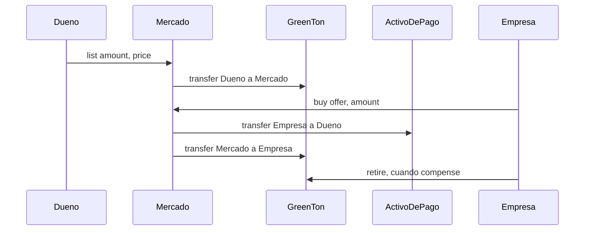

# Pagos: mercado de GreenTon en Stellar

> **Reemplazado** por [ADR 0001](adr/0001-lotes-y-compra-retiro-atomico.md). Este diseño suponía que GreenTon no cambiaba y que comprar y quemar eran dos actos separados. La versión vigente usa GreenTon v2 con lotes y un mercado que compra y quema en la misma transacción ([`contracts/market`](../contracts/market/src/lib.rs)). Se conserva como antecedente.

Propuesta para que el dueño del campo cobre cuando una empresa le compra GTON, dentro de la misma transacción en la que la empresa los recibe. Es un diseño documentado. **No está implementado ni desplegado.**

Contexto del sistema actual: [`docs/vista-lider-tecnico.md`](vista-lider-tecnico.md).

## El problema

GreenTon emite, transfiere y quema. No tiene precio ni pago ([`contracts/greenton/src/lib.rs`](../contracts/greenton/src/lib.rs)). Hoy una venta tiene dos pasos sin relación entre sí:

1. El dueño transfiere GTON a la empresa con `transfer`.
2. La empresa le paga por fuera (banco, acuerdo privado).

Si uno cumple y el otro no, nada en el sistema lo impide ni lo registra. El dueño puede entregar y no cobrar. La empresa puede pagar y no recibir.

## Qué se propone

Un contrato nuevo de **mercado**, en Soroban, al lado de GreenTon:

- El dueño **publica una oferta**: cuántos GTON vende y a qué precio por tonelada.
- La empresa **compra** toda la oferta o una parte. En una sola transacción paga con un activo de Stellar a la cuenta del dueño y recibe los GTON en la suya.
- Si el pago o la entrega fallan, no ocurre ninguno de los dos.
- La empresa **quema** los GTON cuando compensa, con el `retire` que ya existe. Comprar y compensar quedan como dos actos separados.

GreenTon no cambia. El contrato desplegado (`CCNQ7X37…`) sigue con el mismo ID, los mismos predios y los mismos saldos.

## La restricción que define el diseño

`transfer` de GreenTon exige la firma de quien entrega. No hay `approve` ni `transfer_from`, así que ningún contrato puede mover los GTON del dueño en el momento de la compra.

Por eso el mercado **custodia** los GTON desde que se publica la oferta. Al publicar, el dueño firma una transferencia de sus GTON a la cuenta del contrato de mercado. Al comprar, el mercado entrega desde su propio saldo, y para eso no necesita la firma del dueño.

La alternativa era agregar ofertas y pago dentro de GreenTon. Se descartó: obliga a un redeploy, a un ID nuevo de contrato, y a volver a registrar y verificar los predios.

## Cómo se alinea con Dosel

- **El satélite sigue decidiendo cuántos GTON existen.** El mercado no emite. Solo mueve GTON que el oráculo ya acuñó.
- **La venta queda en el mismo registro público** que la emisión y la quema. Cualquiera puede ver en Stellar Expert quién vendió, a quién, cuánto y a qué precio.
- **La quema conserva su sentido.** Comprar no es compensar. La empresa puede tener los GTON y retirarlos a su nombre cuando corresponda, con el registro de beneficiario que ya existe.
- **Sin backend nuevo.** Igual que hoy, la web lee y firma contra el RPC de Stellar.

## Qué se implementa

### Contrato `market`

Nuevo miembro del workspace en `contracts/market/`. Se configura al desplegar con dos direcciones: la de GreenTon y la del activo de pago.

| Función | Firma | Qué hace |
|---|---|---|
| `list(seller, amount, price_per_ton) -> u32` | Vendedor | Mueve `amount` GTON a custodia y crea la oferta. Devuelve su ID. |
| `buy(buyer, offer_id, amount)` | Comprador | Paga `amount × price_per_ton` al vendedor, entrega `amount` GTON al comprador y descuenta de la oferta. |
| `cancel(seller, offer_id)` | Vendedor de esa oferta | Devuelve al vendedor los GTON que no se vendieron y cierra la oferta. |
| `get_offer(offer_id)` | Nadie | Vendedor, cantidad disponible, precio y si está abierta. |
| `offer_count()` | Nadie | Cantidad de ofertas creadas, para recorrerlas desde la web. |

Eventos `Listed`, `Bought` y `Cancelled`. Errores para monto o precio inválido, oferta inexistente o cerrada, cantidad mayor a la disponible, y cancelación por alguien que no es el vendedor.

El producto `amount × price_per_ton` va en `i128`. El perfil release del workspace ya tiene `overflow-checks = true`, así que un desborde aborta la transacción en lugar de cobrar un monto equivocado.

### Activo de pago

Cualquier activo de Stellar a través de su **Stellar Asset Contract (SAC)**, la interfaz de token estándar que la red expone para XLM y para cada activo emitido. El mercado llama a `transfer(buyer, seller, total)` del SAC.

- **Testnet:** XLM nativo. Friendbot fondea las cuentas y no pide trustline.
- **Producción:** USDC en Stellar. El dueño crea una trustline al activo una sola vez antes de cobrar.

El activo es un argumento del constructor, no una constante del código. El precio se expresa en la unidad mínima del activo (XLM y USDC en Stellar usan 7 decimales: 1 unidad = 10.000.000).

### Web

Un panel de **mercado** junto al de retiro:

- Lista de ofertas abiertas: vendedor, toneladas disponibles, precio por tonelada.
- Comprar: la empresa conecta Freighter, elige cantidad, ve el total y firma.
- Con la cuenta del dueño: publicar una oferta y cancelar las propias.

`web/src/chain.ts` ya tiene, dentro de `retire`, la secuencia completa: preparar la transacción, firmar con Freighter, enviar y esperar la confirmación. Esa secuencia se extrae a una función común para `retire`, `list`, `buy` y `cancel`. `web/src/config.ts` suma el ID del contrato de mercado y el del activo de pago.

### Pruebas

Tests de host para `market`, con el patrón de [`contracts/greenton/src/test.rs`](../contracts/greenton/src/test.rs): registrar GreenTon, registrar un SAC de prueba, emitir GTON con el oráculo y verificar saldos.

Se prueba lo que ve un usuario: saldos de GTON y del activo de pago, y el estado de cada oferta. No se prueba la forma del almacenamiento interno.

Casos: publicar y verificar la custodia, comprar entera, comprar en partes, cancelar con remanente, comprar más de lo disponible, comprar con saldo de pago insuficiente, cancelar desde otra cuenta, y que una compra fallida no deje ni el pago ni la entrega a medias.

### Deploy

1. `stellar contract build` compila los dos contratos.
2. Se obtiene el ID del SAC de XLM: `stellar contract id asset --asset native --network testnet`.
3. Se despliega `market` con el ID de GreenTon, el del SAC, la cuenta de tesorería y la comisión en puntos básicos (`--treasury`, `--fee_bps`; 500 = 5 %, tope 1000) como argumentos del constructor.
4. Se actualizan `web/src/config.ts` y el README con el ID nuevo del mercado.

Con el modelo de negocio ([`docs/specs/modelo-de-negocio.md`](specs/modelo-de-negocio.md)) GreenTon **sí** se redespliega, porque `register_parcel` pasa a exigir la firma del admin; hay que volver a registrar y verificar los predios.

## Tecnologías

| Pieza | Tecnología | Por qué |
|---|---|---|
| Contrato de mercado | Rust, `soroban-sdk` 29 | Es la misma pila de GreenTon. Corre en la misma red y llama a GreenTon y al SAC entre contratos. |
| Pago | Stellar Asset Contract (XLM en Testnet, USDC en producción) | Es el token estándar de la red. Liquida en segundos y no pide un contrato de pago propio. |
| Atomicidad | Transacción de Soroban | Si una llamada interna falla, se revierte toda la transacción, pago incluido. |
| Firma | Freighter | Es la billetera que ya usa la web para `retire`. |
| Cliente | `@stellar/stellar-sdk` sobre el RPC de Testnet | Igual que hoy. No hay servidor propio. |
| Interfaz | React 19, Vite, TypeScript | Igual que hoy. Es un panel más. |
| Pruebas | `cargo test` con `soroban-sdk` testutils | Igual que hoy. La CI existente las corre sin cambios. |

## Límites

- **No prueba la procedencia del lote.** GTON es fungible y no guarda de qué predio salió cada token. Una oferta no dice “estas toneladas son de IMPEN1”.
- **Un predio congelado no frena la venta.** El congelamiento corta las emisiones nuevas. Los GTON emitidos antes se pueden ofertar igual.
- **El dueño cobra en Stellar, no en el banco.** Recibe XLM o USDC en su cuenta. Pasarlo a pesos en una cuenta bancaria pide un exchange o una rampa que opere ese activo, y queda fuera de esta propuesta.
- **El precio lo fija el vendedor.** No hay subasta, precio de referencia, comisión de plataforma ni precio por predio.
- **Mientras una oferta está abierta, los GTON no están en la cuenta del dueño.** Para usarlos tiene que cancelar la oferta.
- **Solo Testnet**, como el resto del prototipo.
