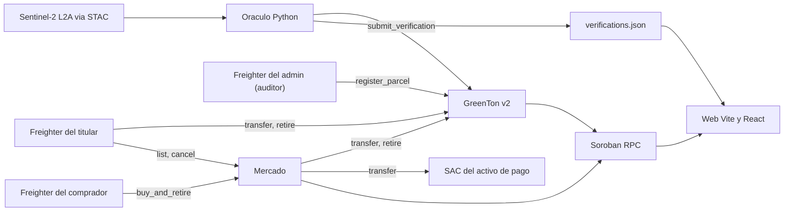
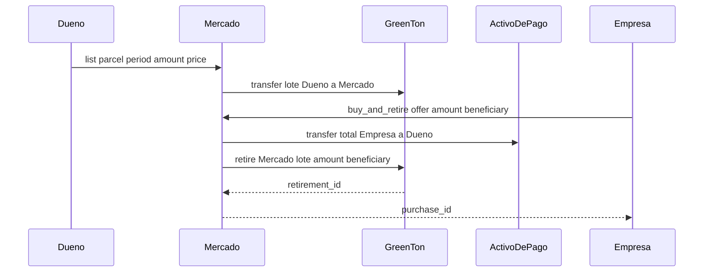

# Especificación Técnica: Plataforma Dosel (CarbonTrack NEA)

**Versión:** 2.0.0  
**Fecha:** Octubre 2026  
**Objetivo:** Definir el núcleo on-chain de Dosel (emisión por lotes verificados por satélite, mercado con compra y quema atómica), el oráculo y la web, sobre Stellar/Soroban. La persistencia en Supabase y el indexador quedan para una fase siguiente.

Decisiones de esta versión: [ADR 0001](adr/0001-lotes-y-compra-retiro-atomico.md). Vocabulario: [`GLOSSARY.md`](../GLOSSARY.md).

---

## 1. Qué cambió respecto de la versión 1.1

| Tema | v1.1 | v2.0 |
|---|---|---|
| Procedencia | Oferta con `parcel_id` sobre un token sin memoria de predio | Saldos por **lote** (predio, período) en el contrato |
| Compra | "Buy & Retire" sin decir quién firma la quema | El mercado custodia el lote y quema como titular, en la misma transacción del pago |
| Billetera | Semilla cifrada en la base de la app | Solo Freighter. La plataforma no guarda claves |
| Pago | USDC/XLM por Freighter "o pasarela simulada" | Activo de Stellar vía su SAC. XLM en Testnet |
| Congelamiento | Descripto como irreversible | Como en el contrato: reversible por el admin, no afecta lotes ya emitidos |
| Metodología | "Verra VM0007, IPCC Tier 2/3" | Factor ilustrativo. No hay metodología certificada |
| Supabase e indexador | Parte del MVP | Fase siguiente (sección 7) |

---

## 2. Alcance

### 2.1. Nos corresponde
1. **Contratos Soroban:** registro de predios, emisión por lote según NDVI, congelamiento, retiro, y mercado con compra-quema atómica.
2. **Oráculo satelital:** Sentinel-2 L2A vía STAC (Planetary Computer en el prototipo), NDVI sobre el bbox del predio y cálculo ilustrativo de tCO₂e.
3. **Web:** explorador público de predios y lotes, mercado, cuenta del titular (lotes, ofertas, retiro) y registro público de retiros.

### 2.2. No nos corresponde
1. **Validación legal de títulos.** Dosel no dictamina si una escritura es legítima.
2. **Metodología de carbono.** El factor actual (5,5 tCO₂e/ha/año a vigor máximo, escalado por NDVI) es ilustrativo. Una metodología reconocida (Verra, Plan Vivo, IPCC) exige región de referencia, fugas, incertidumbre y buffer, y es un paso posterior.
3. **Operación de satélites.** Se consumen datos públicos de ESA.

---

## 3. Arquitectura

No hay servidor propio. La web lee el estado simulando llamadas contra el RPC y firma con Freighter.

---

## 4. GreenTon v2 (`contracts/greenton`)

- **Lote:** `Lot { parcel: Symbol, period: u32 }`. Lo crea `submit_verification` cuando emite, y guarda `LotInfo { minted, ndvi_milli, ledger_time }`.
- **Registro de predios:** `register_parcel` exige la firma del **admin** (auditor), que da de alta el predio a nombre del `owner` después de verificar titularidad y polígono fuera de la cadena. El propietario ya no puede registrar por su cuenta.
- **Reglas que no cambian:** solo el oráculo emite; una emisión por predio y período, y el período se consume aunque congele; NDVI < 0,400 o caída > 0,150 respecto de la línea base congela y emite 0; `unfreeze` solo lo hace el admin, y la línea base pasa al último NDVI medido.
- **Token por lotes:** `transfer(from, to, parcel, period, amount)`, `retire(holder, parcel, period, amount, beneficiary) -> u32`, `lot_balance`, `lots_of(who)`, `get_lot`, y `balance(who)` como suma de todos los lotes.
- **Registro de retiros:** `Retirement { holder, parcel, period, amount, beneficiary, ledger_time }`.
- **Eventos:** `ParcelRegistered`, `Minted`, `Frozen`, `Transferred` y `Retired`, todos con el lote.

No implementa la interfaz SEP-41: un saldo sin lote no tiene sentido en este modelo.

---

## 5. Mercado (`contracts/market`)

Se configura al desplegar con el ID de GreenTon, el del SAC del activo de pago, la cuenta de **tesorería** y la **comisión de plataforma** en puntos básicos (`fee_bps`, de 0 a `MAX_FEE_BPS` = 1000, es decir, hasta 10 %). Un valor mayor al tope hace fallar el despliegue.

| Función | Firma | Qué hace |
|---|---|---|
| `list(seller, parcel, period, amount, price_per_ton) -> u32` | Vendedor | Mueve las toneladas del lote a custodia del mercado y crea la oferta |
| `buy_and_retire(buyer, offer_id, amount, beneficiary) -> u32` | Comprador | Cobra `amount × price_per_ton`: la parte `fee` va a la tesorería y el resto al vendedor; quema `amount` del lote a nombre de `beneficiary`. Devuelve el ID de la compra |
| `cancel(seller, offer_id)` | Vendedor de la oferta | Devuelve el remanente y cierra la oferta |
| `get_offer`, `offer_count`, `get_purchase`, `purchase_count`, `fee_bps`, `treasury` | Nadie | Lectura |

- **Atomicidad:** el pago y la quema son llamadas entre contratos en la misma transacción. Si cualquiera falla, se revierte todo.
- **Quién firma la quema:** el mercado llama a `retire` con su propia dirección como titular. Soroban autoriza a un contrato que invoca directamente con su dirección, así que no hace falta otra firma.
- **Precio:** en la unidad mínima del activo (7 decimales en XLM y USDC). El total va en `i128` con `overflow-checks`.
- **Comisión:** `fee = paid × fee_bps / 10.000`, redondeado hacia abajo (a favor del vendedor). El vendedor recibe `paid − fee`, así que vendedor más tesorería siempre suman lo que pagó el comprador. Con `fee_bps = 0` la tesorería no recibe nada.
- **Registro:** `Purchase { buyer, offer_id, amount, paid, fee, retirement_id }` y el evento `Purchased`. En el retiro de GreenTon, el titular es la dirección del mercado.
- **Errores:** monto inválido, precio inválido, oferta inexistente, oferta cerrada, cantidad mayor a la disponible, vendedor equivocado.

### Flujo de compra

La empresa necesita una cuenta de Stellar con saldo del activo de pago y Freighter. Una pasarela en moneda local queda fuera de alcance: no liquida dentro de una transacción Soroban.

---

## 6. Oráculo y web

- **Oráculo** (`oracle/run.py`): sin cambios de interfaz. `register` da de alta los predios y `verify` reporta NDVI y toneladas. Cada entrada de `web/public/verifications.json` se identifica por predio y período, es decir, por lote. La evidencia del contrato v1 está archivada en `web/public/verifications.v1.json`.
- **Web** (`web/src`):
  - Explorador de predios con evidencia satelital por lote.
  - Mercado: ofertas abiertas con lote, NDVI del lote, toneladas, precio y un aviso si el predio quedó congelado después. Si el mercado cobra comisión, el modal de compra desglosa cuánto va al vendedor y cuánto a la plataforma; el de oferta muestra el neto que recibe el propietario.
  - Mi cuenta: lotes propios, publicar y cancelar ofertas, retirar de un lote propio.
  - Registro de retiros con el lote de origen y un enlace al certificado de cada uno.
  - Certificado de compensación (`#/certificado/N`): lote, verificación satelital, escena, comprador y pago, hash de la transacción de emisión y de la de retiro, y un QR al contrato. Es imprimible. Mi cuenta lista también los retiros hechos al comprar en el mercado, con su certificado.
  - Los IDs de los contratos llegan por `VITE_GREENTON_ID`, `VITE_MARKET_ID` y `VITE_PAYMENT_ASSET_ID`.

---

## 7. Fase siguiente: persistencia e indexación

Fuera de esta versión. Restricciones para cuando se encare:

- **La cadena es la fuente.** Postgres es un caché de lectura. El indexador usa `getEvents` con un cursor de ledger durable y aplica cada evento una sola vez (clave: hash de la transacción más índice del evento).
- **La metadata de la escena no viaja en los eventos.** La escribe el oráculo junto con el hash de la transacción. Una lectura rechazada se guarda sin hash.
- **Geometría:** `geography(MultiPolygon, 4326)`, con hectáreas calculadas con `ST_Area` y no cargadas a mano. El solape con otros predios se valida antes de `register_parcel`.
- **Estado inicial del predio:** pendiente de validación documental, no activo.
- **Claves:** nunca en la base. Si hace falta custodia asistida, un KMS o passkeys.
- **Auth y permisos:** Supabase Auth con RLS en todas las tablas expuestas.

---

## 8. Estado de despliegue de estos cambios

Los contratos oficiales de la demo (IDs en el README) corresponden al tag `contratos-desplegados-testnet` y **no tienen** la comisión ni el registro por admin: la web lo detecta y no muestra desglose de comisión cuando `fee_bps` no existe. El código de `main` ya los incluye. Se pueden probar en Testnet con contratos de prueba propios con `scripts/probar-modelo-negocio.sh` (ver `DEPLOY.md`, sección 6).

Siguen sin implementarse, por requerir cambios de contrato y un nuevo despliegue: el fondo de reserva y el cargo de alta (ver `docs/specs/modelo-de-negocio.md`, §5.2 y §5.3), y el formulario privado de alta con KYC (Supabase).

