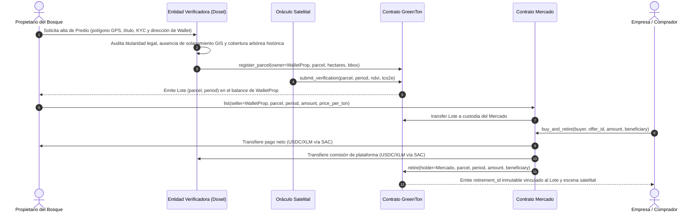

# Especificación de Modelo de Negocio y Flujo Operativo: Dosel (CarbonTrack NEA)

**Versión:** 1.0.0  
**Fecha:** Octubre 2026  
**Estado:** Propuesta de definición para cierre de producto  
**Documentos relacionados:** [`GLOSSARY.md`](../../GLOSSARY.md) · [ADR 0001](../adr/0001-lotes-y-compra-retiro-atomico.md) · [ADR 0002](../adr/0002-alcance-del-modelo-de-negocio.md) · [`docs/spec-sistema-completo.md`](../spec-sistema-completo.md) · [`docs/validacion.md`](../validacion.md)

---

## 1. Propósito del documento

Definir el modelo de negocio integral de **Dosel** y el flujo operativo de punta a punta desde que un propietario solicita el alta de un **Predio** hasta que una empresa o entidad realiza el **Retiro** de toneladas de **GreenTon (GTON)** y obtiene su certificación de compensación ambiental.

Este documento establece:
1. Qué hace exactamente el código desplegado hoy y dónde existen brechas respecto del flujo comercial objetivo.
2. El flujo operativo ideal en cuatro etapas (Alta curada, Emisión por Oráculo, Mercado y Certificación).
3. El esquema de monetización de la plataforma en cada etapa.
4. Las variantes de arquitectura y producto pendientes de decisión, con sus ventajas, contrapartidas y recomendación técnica.

---

## 2. Vocabulario canónico

Para evitar ambigüedades entre el dominio legal, el geoespacial y el de los contratos en Soroban, este documento respeta estrictamente el glosario del proyecto ([`GLOSSARY.md`](../../GLOSSARY.md)):

- **Predio (`parcel`):** Unidad territorial delimitada por un polígono geográfico GPS registrada por un propietario para la conservación de bosque nativo. No debe confundirse con un **Lote**.
- **Lote (`Lot`):** Las toneladas de **GreenTon (GTON)** emitidas para un **Predio** en un período determinado, identificadas de forma única por el par `(predio, período)`.
- **GreenTon (GTON):** Token en Soroban equivalente a 1 tonelada de CO₂ equivalente ($1\text{ GTON} = 1\text{ tCO}_2\text{e}$) capturada o protegida de deforestación. Siempre pertenece a un **Lote**.
- **Oferta (`Offer`):** Publicación en el contrato de **Mercado** de una cantidad de GTON de un **Lote** específico a un precio fijo por tonelada. Mientras la oferta está abierta, las toneladas permanecen en custodia del contrato de mercado.
- **Retiro (`Retirement`):** Quema irreversible de tokens GTON de un **Lote** en el contrato inteligente para certificar el aporte ambiental o la compensación de huella de carbono de un beneficiario.

---

## 3. Contraste con la implementación actual (Estado v2 en Testnet)

Antes de fijar el modelo objetivo, es necesario contrastar las suposiciones operativas con el comportamiento real del código actual:

| Aspecto | Qué ocurre hoy en el código | Ajuste requerido para el modelo de negocio |
|---|---|---|
| **Solicitud de alta de Predio** | El botón «Proponer un predio» ([`ProposeParcel.tsx`](../../web/src/components/ProposeParcel.tsx)) abre un issue público en GitHub con coordenadas y contacto. | Pasar a un formulario privado de solicitud con carga de documentación respaldatoria (título, catastro, KYC y wallet del propietario) en base de datos (Supabase). |
| **Registro on-chain (`register_parcel`)** | En [`contracts/greenton/src/lib.rs`](../../contracts/greenton/src/lib.rs), `register_parcel` solo exige `owner.require_auth()`. Cualquier cuenta puede registrar un polígono por su cuenta, y el administrador no puede registrarlo sin la firma del propietario. | Exigir autorización de la entidad verificadora (`admin.require_auth()`) para que solo entren al contrato predios auditados, asignando la dirección `owner` del titular. |
| **Publicación en el Mercado (`list`)** | Registrar un predio y emitir un lote **no** lo publica automáticamente en el mercado. El propietario debe llamar a `list` en [`contracts/market/src/lib.rs`](../../contracts/market/src/lib.rs) para fijar el precio y transferir el lote a custodia. | Mantener la decisión de precio en manos del propietario (o permitir un mandato/automatización opcional al momento del alta). |
| **Compra vs. Retiro (`buy_and_retire`)** | En la versión 2 ([ADR 0001](../adr/0001-lotes-y-compra-retiro-atomico.md)), comprar en el mercado **quema inmediatamente** los tokens en la misma transacción (`buy_and_retire`). El comprador no recibe GTON transferibles desde el mercado. | Decidir si el mercado público se mantiene 100 % con quema inmediata (recomendado contra greenwashing) o si se habilita una variante de compra con tenencia para revender. |
| **Comisión de plataforma** | `buy_and_retire` transfiere el 100 % del pago (`amount * price_per_ton`) del comprador al vendedor. | Dividir atómicamente el pago en el contrato de mercado: $(100\% - \text{comisión})$ al propietario y $\text{comisión}$ a la tesorería de Dosel. |
| **Certificación post-retiro** | El contrato guarda el registro inmutable `Retirement` y `Purchase`, y la web los lista en la sección Transparencia ([`Transparency.tsx`](../../web/src/pages/Transparency.tsx)). | Generar una vista de certificado verificable e imprimible/descargable con enlace directo al lote, escena satelital Sentinel-2 y transacción en Stellar Expert. |

---

## 4. Flujo operativo ideal (Punta a Punta)

### Etapa 1: Solicitud, Verificación Documental y Alta del Predio (Off-chain $\rightarrow$ On-chain)

El alta de un **Predio** nunca es libre ni autogestionada directamente contra el contrato inteligente, porque el satélite puede medir si hay árboles en un polígono, pero **no puede saber quién es el dueño legal de esa tierra ni si el polígono se solapa con el de un vecino**.

1. **Postulación del Propietario:** El propietario (o un originador local/ONG que lo asiste) conecta su billetera Stellar (Freighter) en la web y envía una solicitud de alta adjuntando:
   - Polígono geográfico exacto (GeoJSON / coordenadas WGS84).
   - Documentación legal de titularidad o posesión legítima (escritura, matrícula catastral, inscripción provincial).
   - Identidad del titular y dirección pública de su billetera Stellar (`G...`).
2. **Auditoría por la Entidad Verificadora (Dosel / Auditor):**
   - **Validación documental y catastral:** Verifica que quien postula tiene derecho legal sobre el inmueble y sobre los servicios ecosistémicos.
   - **Validación geoespacial previa (PostGIS + Cobertura):** Calcula la superficie real con `ST_Area`, comprueba que el polígono no se solape con ningún otro **Predio** registrado (`ST_Overlaps` / `ST_Intersects`) y verifica mediante cobertura histórica del suelo (`io-lulc-annual-v02`) que el área sea efectivamente bosque nativo y no tierra agrícola estacional (evitando el falso positivo documentado en `TACOP1`).
3. **Alta on-chain:** Una vez aprobado el expediente, se registra el **Predio** en el contrato `GreenTon` asociando la dirección de billetera del propietario (`owner`) con el identificador del predio, las hectáreas validadas y el bounding box.

### Etapa 2: Monitoreo Satelital y Emisión de Lotes

1. **Medición periódica:** En cada período de corte, el **Oráculo** consulta escenas de Sentinel-2 L2A (nubes $< 20\%$), calcula el NDVI medio del polígono y cruza con la cobertura de suelo.
2. **Regla de conservación:**
   - Si el NDVI supera el mínimo ($0{,}400$) y no cayó más de $0{,}150$ respecto de la **Línea Base**, el contrato emite el **Lote** `(predio, período)` directamente a la billetera del propietario.
   - Si el NDVI cae por debajo del umbral, el contrato ejecuta el **Congelamiento** automático del predio, emite $0\text{ GTON}$ y consume el período para impedir reintentos fraudulentos.

### Etapa 3: Publicación en el Mercado y Liquidación Atómica

1. **Publicación de Oferta:** El propietario ingresa a «Mi cuenta» con su billetera conectada, selecciona un **Lote** emitido, define cuántas toneladas desea poner a la venta y a qué precio unitario (en USDC en producción, XLM en Testnet), y firma `list`. Las toneladas quedan en custodia del contrato de **Mercado**.
2. **Compra por Empresas o Individuos:** Cualquier empresa (para compensar su huella de carbono operativa o financiar conservación) o individuo elige un **Lote** específico viendo su origen geográfico y su evidencia satelital.

### Etapa 4: Retiro y Certificación de Impacto Ambiental

Al concretarse el **Retiro**, los tokens GTON se destruyen de forma permanente del suministro circulante (`total_supply` disminuye y `total_retired` aumenta) y se genera el registro inmutable `Retirement` con un identificador secuencial único (`retirement_id`).

---

## 5. Modelo de Negocio y Monetización

Para que **Dosel** sea financieramente sostenible sin encarecer la entrada a pequeños y medianos propietarios forestales del Gran Chaco/NEA, la captura de valor se estructura en tres fuentes complementarias:

### 5.1. Comisión Transaccional en el Mercado (Fuente principal — *Take Rate*)
- **Cómo funciona:** Cuando una empresa ejecuta la compra en el contrato de **Mercado**, el pago en stablecoin (USDC vía SAC) se divide atómicamente en la misma transacción:
  - **$92\% - 95\%$** va directo a la billetera del propietario del **Predio**.
  - **$5\% - 8\%$** va a la billetera de tesorería de **Dosel**.
- **Por qué es óptimo:** Alinea los incentivos de la plataforma con los del propietario (Dosel cobra si el propietario logra vender) y no requiere facturación ni cobranza manual fuera de la cadena.

### 5.2. Cargo de Verificación y Alta de Predio (*Onboarding Fee*)
- **Cómo funciona:** Revisar escrituras, matrículas catastrales y poligonales GIS tiene un costo operativo real por cada solicitud. Existen dos modalidades para cubrirlo:
  - **Modalidad A (Sin barrera de entrada — Recomendada para productores locales):** El alta inicial es gratuita en efectivo; el costo de validación documental se recupera reteniendo un pequeño porcentaje adicional sobre la primera venta o sobre el primer **Lote** emitido (ej. $3\% - 5\%$ de los GTON del primer período).
  - **Modalidad B (Cargo fijo de auditoría):** Cobro de un arancel fijo en USDC/moneda local al presentar la carpeta para cubrir el trabajo del auditor legal/agrónomo, evitando solicitudes spam.

### 5.3. Retención de Garantía Ambiental (*Buffer Pool* + Comisión de Oráculo)
- **Cómo funciona:** Siguiendo las buenas prácticas de los estándares de carbono, al emitir un **Lote** en `submit_verification`, una fracción (ej. $10\%$ de las toneladas calculadas) no se acredita como saldo libre sino que se destina a:
  - Un **Fondo de Reserva (*Buffer Pool*)** on-chain para cubrir eventuales reversiones (incendios o desmontes ilegales futuros en predios de la red).
  - Una comisión de mantenimiento del **Oráculo** e infraestructura de monitoreo continuo.

---

## 6. Decisiones de Producto y Variantes de Arquitectura

En esta sección se detallan las tres decisiones estratégicas planteadas para el cierre del modelo, junto con sus variantes y la recomendación para el proyecto.

### Decisión 1: ¿Quién ejecuta el registro on-chain tras la validación documental?

| Variante | Cómo funciona | Ventajas | Contrapartidas |
|---|---|---|---|
| **1A. Alta ejecutada por el Verificador (`admin`)** *(Recomendada)* | El propietario envía su documentación y firma un mensaje o conecta su wallet en el formulario web. Una vez aprobada la carpeta, el administrador de Dosel invoca `register_parcel(owner, parcel, hectares, bbox)` con `admin.require_auth()`. | - Garantiza que ningún predio no auditado entre al contrato. - El propietario no paga gas ni necesita firmar una segunda vez cuando termina la auditoría. - El `owner` queda fijado directamente a la wallet del dueño. | Requiere cambiar `owner.require_auth()` por `admin.require_auth()` en `register_parcel` dentro de [`contracts/greenton/src/lib.rs`](../../contracts/greenton/src/lib.rs). |
| **1B. Doble firma (`admin` + `owner`)** | La plataforma aprueba la solicitud y habilita al propietario un botón en la web para que él mismo firme el alta autorizada por el admin. | Prueba criptográfica on-chain de que el propietario aceptó los términos exactos del polígono registrado. | Suma fricción: el propietario debe volver a entrar a la app luego de días de revisión documental para firmar. |

> **Recomendación:** **Variante 1A** para la operación en cadena, complementada con **Variante 1A + mandato opcional de publicación**: que el propietario siga siendo quien publica la **Oferta** (`list`) desde su cuenta para elegir libremente a qué precio vender sus toneladas.

---

### Decisión 2: ¿Qué ocurre al comprar en el Mercado? (Quema inmediata vs. Comercio secundario)

Esta es la definición más importante del ciclo de vida del token **GreenTon (GTON)**.

| Variante | Cómo funciona | Ventajas | Contrapartidas |
|---|---|---|---|
| **2A. Compra y Retiro Atómico (`buy_and_retire`)** *(Implementada hoy en v2 — Recomendada como flujo principal)* | Comprar en el mercado y quemar el token son un único acto indivisible. La empresa paga al dueño y el contrato destruye los GTON en la misma transacción a nombre del beneficiario. | - **Cero especulación y cero greenwashing:** nadie puede comprar créditos baratos para revenderlos ni declarar que "compensó" mientras mantiene el token vivo para venderlo después. - **Simplicidad UX y contable:** la empresa compradora solo necesita USDC/XLM; no tiene que gestionar saldos de GTON ni firmar dos transacciones. - **Trazabilidad limpia:** cada compra produce inmediatamente su certificado de retiro. | No permite que un intermediario (broker, distribuidor o fondo climático) compre un bloque grande en el mercado para revenderlo fraccionado más adelante desde la misma interfaz. |
| **2B. Compra con Tenencia y Retiro Diferido (`buy` + `retire` separados)** | Al comprar en el mercado, los GTON del **Lote** se transfieren de la custodia del mercado a la billetera del comprador. El comprador puede conservarlos, volver a publicarlos en el mercado (`list`) o quemarlos cuando desee (`retire`). | - Habilita un **mercado secundario** con liquidez entre traders, brokers y empresas. - Permite a una empresa comprar créditos a lo largo del año y quemarlos todos juntos al cierre de su balance ambiental anual. | - **Riesgo reputacional alto:** una empresa puede anunciar públicamente que "compró bonos de carbono" sin quemarlos y luego revenderlos. - Mayor fricción para el comprador final (dos transacciones: comprar y luego retirar). |
| **2C. Modelo Híbrido (Mercado de Retiro + Transferencia/OTC para Mayoristas)** *(Recomendada para escalar)* | En la interfaz de **Mercado** público para empresas, la acción por defecto es `buy_and_retire` (quema inmediata). En paralelo, dado que `GreenTon` ya posee `transfer(from, to, parcel, period, amount)`, se mantiene o agrega en el mercado una opción explícita de «Adquirir en custodia / Mayorista» (`buy_to_hold`) claramente diferenciada de una compensación. | - Conserva la pureza de «Comprar es compensar» para el 95 % de las empresas que buscan el certificado ambiental. - No bloquea casos de uso B2B mayoristas (ej. una cooperativa o agregador que compra a pequeños productores y luego retira a nombre de sus clientes finales). | La interfaz debe dejar taxativamente claro que **tener GTON en la billetera NO certifica compensación alguna** hasta que se ejecute `retire`. |

> **Recomendación para cerrar el modelo:** Adoptar la **Variante 2A (`buy_and_retire`) como regla de oro del Mercado público**, explicando como ventaja competitiva de **Dosel** que el protocolo impide por diseño la doble contabilidad y la especulación secundaria sin retiro real. Si se desea contemplar el caso mayorista en la documentación comercial, plantear la **Variante 2C** aclarando que el certificado ambiental **solo nace con la quema (`retire`)**, jamás con la mera tenencia del token.

---

### Decisión 3: ¿Cómo se instrumenta la Certificación por el aporte ambiental?

Cuando una empresa o persona quema GTON (ya sea vía `buy_and_retire` en el mercado o vía `retire` directo), el sistema debe otorgarle un respaldo verificable de su aporte a la conservación del bosque nativo (sea para compensar su propia huella de carbono o como contribución climática voluntaria).

| Nivel de Certificación | Qué incluye y cómo funciona | Estado actual / Esfuerzo |
|---|---|---|
| **Nivel 1: Registro Público On-Chain (`Retirement`)** | El contrato `GreenTon` graba de forma permanente: `retirement_id`, `holder`, `parcel` (Predio), `period` (Período del Lote), `amount` (tCO₂e quemadas), `beneficiary` (razón social/nombre y motivo) y `ledger_time` (timestamp del ledger). | **Ya implementado** en [`contracts/greenton/src/lib.rs`](../../contracts/greenton/src/lib.rs) y visible en [`Transparency.tsx`](../../web/src/pages/Transparency.tsx). |
| **Nivel 2: Certificado Digital Verificable (URL única + PDF con QR)** *(Recomendado para cierre de producto)* | Cada `retirement_id` tiene una vista dedicada en la web (ej. `/#/certificado/<retirement_id>`) lista para imprimir o exportar en PDF que muestra: 1. Nombre del beneficiario y toneladas de $\text{CO}_2\text{e}$ retiradas. 2. Datos del **Predio** y polígono geográfico conservado. 3. Evidencia satelital del **Lote**: NDVI medido, ID de escena Sentinel-2 L2A y fecha. 4. Hash de la transacción y código QR que apunta al contrato en Stellar Expert para auditoría externa sin depender de Dosel. | **Óptimo en relación impacto/esfuerzo:** todos los datos ya existen on-chain y en `verifications.json`; solo requiere una vista de certificado sobre los datos actuales. |
| **Nivel 3: Credencial On-Chain No Transferible (*Soulbound Badge*)** | Al ejecutar `retire`, el contrato emite o indexa un comprobante no transferible asociado a la cuenta `buyer` que las billeteras o perfiles corporativos pueden exhibir. | Innecesario como token separado porque el struct `Retirement(id)` más `Purchase(id)` en el almacenamiento persistente de Soroban **ya es** un registro inmutable y no transferible en la cadena. |

> **Recomendación:** Definir como estándar del producto la combinación de **Nivel 1 + Nivel 2**: el respaldo jurídico-técnico vive en el registro `Retirement` del contrato Soroban (inmutable y consultable en Stellar Expert), y la experiencia de usuario para la empresa es el **Certificado Digital Verificable** que vincula en una sola hoja al beneficiario, la transacción de quema y la imagen satelital de Sentinel-2 que dio origen a esas toneladas.

---

## 7. Resumen del Modelo Cerrado (Propuesta Óptima)

1. **Alta curada con respaldo legal y satelital:** Los propietarios postulan sus **Predios** por fuera del contrato enviando polígono GPS, título de propiedad y su billetera Stellar. **Dosel** actúa como entidad verificadora (auditando títulos, no solapamiento GIS y cobertura histórica de bosque) antes de registrar el predio on-chain a nombre de la billetera del propietario.
2. **Emisión objetiva por Lotes:** El **Oráculo** satelital mide el NDVI de cada período y el contrato emite el **Lote** `(predio, período)` en la cuenta del propietario únicamente si el bosque se mantiene en pie.
3. **Mercado de Impacto Directo («Comprar es Compensar»):** El propietario publica ofertas de sus lotes fijando el precio por tonelada. Cuando una empresa compra en el mercado, el pago al propietario, la comisión de plataforma y la quema irreversible (`retire`) ocurren en **una única transacción atómica**, eliminando el riesgo de contraparte y la reventa especulativa.
4. **Certificación con trazabilidad hasta la escena satelital:** Cada quema genera un registro inmutable en Soroban y un **Certificado de Compensación** auditable públicamente que conecta el nombre del beneficiario con las toneladas retiradas, el predio del Gran Chaco/NEA y la escena exacta de Sentinel-2 que verificó la captura.

---

## 8. Estado de implementación (rama `feat/modelo-de-negocio`)

Implementado y probado en local (`cargo test`: 13 + 14 tests, `stellar contract build`, tests del oráculo y `npm run build`). **Nada está desplegado**: la entrega vigente usa los contratos ya publicados en Testnet.

| Punto del spec | Estado | Dónde |
|---|---|---|
| Alta solo por el verificador (Decisión 1A) | Hecho | `register_parcel` exige `admin.require_auth()`; `oracle/run.py register` firma como `admin` |
| Comisión de plataforma atómica (§5.1) | Hecho | El constructor del mercado recibe `treasury` y `fee_bps` (tope 10 %, `MAX_FEE_BPS`); `buy_and_retire` paga `total - fee` al vendedor y `fee` a la tesorería; `Purchase` y el evento guardan `fee`. La comisión se redondea hacia abajo, a favor del vendedor, y la web desglosa neto y comisión antes de firmar cuando `fee_bps > 0` |
| Certificado digital verificable, Nivel 2 (Decisión 3) | Hecho | Vista `/#/certificado/<retirement_id>` (`web/src/pages/Certificate.tsx`), con enlace desde Transparencia y Mi cuenta, hash de la transacción de retiro resuelto desde eventos RPC (`web/public/retirements.json` como respaldo), QR al contrato en Stellar Expert y estilos de impresión a PDF |
| Compra con quema inmediata (Decisión 2A) | Sin cambios | Ya estaba implementada |

**Qué implica desplegarlo:** GreenTon y el mercado cambian de ID (nuevo WASM y nuevo constructor), hay que volver a registrar y verificar los predios, y actualizar `web/src/config.ts` y el README (ver `DEPLOY.md` y [ADR 0002](../adr/0002-alcance-del-modelo-de-negocio.md)).

### Brechas que el spec todavía deja abiertas

1. **Las tarifas se apilan y no se suman en ningún lado.** Comisión de mercado (5–8 %), cargo de alta (3–5 % del primer lote) y *buffer pool* (10 % de cada emisión) pueden quitarle al propietario entre un 18 % y un 23 % del primer lote. Falta una tabla con el neto que recibe el dueño en un ejemplo concreto y un tope global.
2. **El *buffer pool* (§5.3) no está implementado** y choca con la regla «1 GTON = 1 tCO₂e emitida al propietario»: hay que decidir si el 10 % retenido se emite a una cuenta de reserva y quién puede liberarlo.
3. **El formulario privado con documentación (Supabase, §3 y Etapa 1) no existe todavía.** Hoy «Proponer un predio» sigue abriendo un issue público de GitHub con datos de contacto, lo cual es incompatible con subir título y KYC.
4. **Falta decidir la tesorería:** cuenta única o multifirma, y que necesita trustline si cobra en USDC.
5. **Retención del hash de la transacción de retiro pasados 7 días:** el certificado obtiene el hash de quema consultando los eventos del RPC de Soroban (que se conservan ~7 días) y usa `web/public/retirements.json` como respaldo estático para los retiros oficiales; para conservar cualquier retiro histórico de forma automática hace falta un indexador de eventos.
6. **Sin rotación de claves** de `admin`, `oracle` ni `treasury`: ahora el `admin` controla además el alta de predios, así que su compromiso pesa más que antes.
