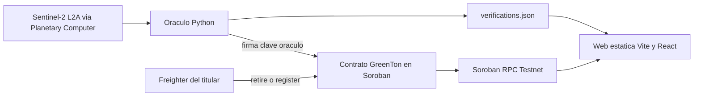

# Dosel — vista de líder técnico

> Este documento describe la **versión 1**, la que está desplegada y se presentó en la hackathon. La versión 2 (saldos por lote y mercado con compra-quema atómica) ya está desplegada en Testnet (IDs en el README): ver [ADR 0001](adr/0001-lotes-y-compra-retiro-atomico.md) y [`spec-sistema-completo.md`](spec-sistema-completo.md).

Documento para entender el sistema, las apuestas y los límites sin recorrer cada función. El detalle operativo de deploy está en [`DEPLOY.md`](../DEPLOY.md). La evidencia del problema está en [`docs/validacion.md`](validacion.md).

## Qué es

**Dosel** emite y retira créditos de carbono de bosque nativo del Gran Chaco y el NEA. El token se llama **GreenTon (GTON)**: 1 GTON = 1 tCO₂e.

Un oráculo mide el NDVI (índice de vegetación) de Sentinel-2 sobre el polígono del predio. El contrato en Soroban emite tokens al propietario si el vigor se mantiene, y congela el predio si el bosque cae. Quien compensa su huella quema los tokens. El registro de emisión y de quema es público.

Es un prototipo del IDEATHON Neatech 2026, track Stellar. Corre solo en **Testnet**. El nombre del producto es Dosel; el del token, grabado en el contrato desplegado, sigue siendo GreenTon.

## Para qué existe

Un crédito de carbono puede apoyarse en la declaración del dueño del campo (un PDF, una certificación de parte). Dosel separa esa declaración de dos cosas que cualquiera puede revisar:

1. Una medición satelital pública del polígono.
2. Un registro on-chain de cuánto se emitió, por qué período, y quién lo quemó.

El contexto de negocio, documentado en [`docs/validacion.md`](validacion.md) a partir de fuentes públicas (Greenpeace, prensa, trabajo académico de la UNNE), es este: la deforestación del norte argentino es grande, y el marco regulatorio del mercado de carbono argentino seguía en el Congreso al momento de la hackathon. El registro vigente (ReNaMi) es chico. Hay además un conflicto abierto sobre a quién pertenecen los bonos (productor o provincia).

La validación del proyecto es documental y técnica. **No hubo entrevistas ni encuestas a propietarios, ONG o empresas compradoras.**

## Por qué el diseño responde al problema

El contrato concentra las reglas que el dueño del campo no puede saltarse. Cuatro propiedades están en el código de [`contracts/greenton/src/lib.rs`](../contracts/greenton/src/lib.rs):

- **Solo el oráculo emite.** `submit_verification` exige la firma de la cuenta oráculo fijada en el constructor.
- **Un predio y un período, una sola vez.** La clave de período se consume aunque el resultado sea congelar. No se puede reintentar el mismo período.
- **Caída de vigor, emisión en cero.** NDVI bajo 0,400, o una caída mayor a 0,150 respecto de la línea base, congela el predio y devuelve 0 toneladas.
- **Compensar es quemar.** `retire` baja el saldo y el suministro, suma al total retirado, y guarda titular, monto, beneficiario y timestamp del ledger.

La web no tiene backend. Lee el contrato por el RPC público de Testnet y muestra, por cada verificación, el enlace a la escena satelital y a la transacción en Stellar Expert. La evidencia de que “el bosque sigue” o “el bosque cayó” queda fuera del PDF del propietario.

En la demo, IMPEN1 y CHACO1 mantienen el NDVI entre 2019 y 2026 y emiten. TACOP1 cae de 0,814 a 0,612, el contrato lo congela y emite cero. **TACOP1 es tierra agrícola, no una tala**: la cobertura del suelo de Impact Observatory lo muestra como ~83 % cultivos desde 2017, así que es un falso positivo del NDVI. Ver [`validacion.md`](validacion.md), sección 3b.

## Dónde el diseño se detiene

Estas limitaciones están dichas en el README y en la validación. Forman parte del alcance del prototipo:

- El oráculo es **una sola clave**. Quien tiene esa clave decide el NDVI y las toneladas que entran al contrato.
- El factor **5,5 tCO₂e/ha/año** a vigor máximo, escalado por NDVI, es ilustrativo. Una metodología certificada (Verra, IPCC u otra) es un paso siguiente.
- Los períodos 2019 y 2026 comparan la misma estación (febrero–marzo). 2019 funciona como línea base histórica, no como siete años de emisión.
- Solo Testnet. Los GTON de la demo no tienen valor de mercado.

## Cómo funciona

Tres piezas. Ningún servidor propio.

1. [`oracle/parcels.json`](../oracle/parcels.json) define tres predios demo por bounding box (IMPEN1, CHACO1, TACOP1).
2. El oráculo busca en Planetary Computer la escena Sentinel-2 L2A de menor nubosidad (tope 20 %), calcula el NDVI medio del bbox y convierte ese NDVI en toneladas.
3. Firma `submit_verification` con la clave `oracle` a través de la CLI de Stellar.
4. El contrato emite al propietario o congela el predio, y publica eventos (`Minted`, `Frozen`, `Retired`).
5. La web lee suministro, predios y retiros simulando llamadas de solo lectura contra el RPC. El mapa y el gráfico salen de ese estado más el archivo estático de evidencia.

### Roles

Quedan fijos en el constructor (`admin`, `oracle`). No hay gobernanza ni rotación de claves.

| Rol | Quién firma | Qué puede hacer |
|---|---|---|
| Admin | Cuenta admin | `register_parcel`: da de alta un predio ya auditado a nombre de su dueño. `unfreeze`: levanta el congelamiento y pasa la línea base al último NDVI |
| Oráculo | Cuenta oráculo | `submit_verification`: reporta NDVI y toneladas del período |
| Propietario | Cuenta fijada en el alta | Recibe lo emitido, publica ofertas (`list`) y las cancela |
| Titular con saldo | Cualquier cuenta con GTON | `transfer` y `retire` |

La interfaz solo muestra los tres predios fijos y el flujo de retiro con Freighter. El alta de predios y la verificación corren por la CLI, no desde la web.

## Tecnologías y por qué están

Cada capa está donde está porque el dato o la regla no caben en la otra.

### Contrato: Stellar / Soroban

Rust, `soroban-sdk` 29, artefacto WASM (`wasm32v1-none`). El track de la hackathon pide confianza inmutable y trazabilidad; el contrato es el lugar de las reglas de emisión, congelamiento y quema. Ahí viven los umbrales, la unicidad del período, los saldos y el registro de retiros.

El oráculo invoca el contrato con `stellar contract invoke` por subproceso ([`oracle/run.py`](../oracle/run.py)). No hay un SDK de Stellar en Python.

### Lectura y firma en el navegador

`@stellar/stellar-sdk` y `@stellar/freighter-api`. La web arma la transacción de `retire`, Freighter la firma en Testnet, y el SDK la envía al RPC `https://soroban-testnet.stellar.org`. Las lecturas se simulan con una cuenta pública fija (la del oráculo): no hace falta que el visitante tenga billetera para ver el estado. El explorador enlazado es Stellar Expert.

### Oráculo geoespacial: Python

Python 3.11 con `pystac-client`, `planetary-computer`, `rasterio` y `numpy`. El contrato no maneja rasters ni punto flotante; el NDVI entra como milésimas enteras (0,612 → 612). El cálculo de la escena, el recorte del bbox y la fórmula de toneladas viven en [`oracle/ndvi.py`](../oracle/ndvi.py) y [`oracle/run.py`](../oracle/run.py).

Detalle que ya corrigió un error real durante el desarrollo: desde el baseline de procesamiento 04.00 de Sentinel-2 (enero 2022), ESA aplica un offset de reflectancia de −0,1. Planetary Computer no lo declara en el asset, así que el oráculo lo aplica según `s2:processing_baseline`. Sin eso, el NDVI de 2026 salía artificialmente más bajo que el de 2019.

### Web estática

Vite, React 19 y TypeScript. Es una demo de solo lectura más una acción (retirar). No hay API propia ni base de datos. El mapa usa Leaflet sobre las teselas satelitales de Esri World Imagery. Las tipografías (Familjen Grotesk, IBM Plex Sans, IBM Plex Mono) se cargan desde Google Fonts.

### Integración continua

[`.github/workflows/ci.yml`](../.github/workflows/ci.yml) corre en cada push y pull request: tests del contrato, build del target WASM, build de la web (Node 22) y tests unitarios del oráculo (Python 3.11). El hosting de la demo, si se publica, es estático: [`DEPLOY.md`](../DEPLOY.md) recomienda Vercel y deja Netlify como alternativa. El repositorio no fija un deploy ya hecho.

### Cómo se construyó

El README declara que el código de la hackathon se escribió con Claude Code (Anthropic). Es una herramienta de construcción, no una dependencia de runtime.

## Plataformas y proveedores

| Pieza | Quién la provee | Para qué se usa |
|---|---|---|
| Red, RPC de Testnet, CLI, SDK y Freighter | Stellar Development Foundation | Contrato, firmas y lectura pública |
| Explorador | Stellar Expert | Verificar contrato y transacciones |
| Imágenes Sentinel-2 L2A | Copernicus / ESA, servidas por Microsoft Planetary Computer (catálogo STAC) | NDVI del predio |
| Teselas del mapa | Esri World Imagery (Maxar, Earthstar Geographics), vía Leaflet | Fondo satelital de la demo |
| Tipografías | Google Fonts | Identidad de la web |
| Repositorio y CI | GitHub / GitHub Actions | Código y chequeos |
| Hosting de la web | Vercel o Netlify (sugeridos, estáticos) | Publicar `web/dist` |
| Asistencia de desarrollo | Anthropic (Claude Code) | Escritura del código durante la hackathon |

El dato satelital es público. Planetary Computer firma el acceso a los assets; el oráculo no opera una estación terrena ni paga una API comercial de imágenes.

## Decisiones que el código ya tomó

No hay ADRs. Estas elecciones están implícitas en el contrato, el oráculo y la web.

**Token fungible, toneladas enteras.** Metadatos al estilo SEP-41: `name` GreenTon, `symbol` GTON, `decimals` 0. Una unidad es una tonelada. Se puede `transfer`ir antes de quemar, así que existe un mercado secundario posible hasta el retiro. El retiro es irreversible. En v2 el saldo pasa a ser por lote (predio, período) para no perder la procedencia en la primera transferencia.

**La cuantificación confía en el oráculo; el freno de deforestación no.** Si el NDVI pasa los umbrales, el contrato acuña el `tco2e` que el oráculo envía. La fórmula (5,5 tCO₂e/ha/año, NDVI escalado entre 0,4 y 0,8) vive solo en Python. Un oráculo malicioso, o simplemente equivocado, puede inflar toneladas mientras el NDVI siga “sano”. El congelamiento automático cubre la caída de vigor, no la honestidad del factor.

**NDVI en milésimas.** Enteros en el ledger. Evita floats en Soroban y deja los umbrales (400 y 150) como constantes del contrato.

**La línea base es la primera verificación.** En el alta, el predio entra con NDVI base 0. La primera `submit_verification` fija ese piso. `unfreeze` lo reemplaza por el último NDVI medido: el auditor humano redefine desde qué vigor se vuelve a medir la caída.

**Las hectáreas se calculan fuera y el contrato solo las guarda.** Al registrar, el oráculo estima la superficie del bbox y la manda en `register_parcel`. `submit_verification` no vuelve a mirar esas hectáreas. El monto emitido es el que firma el oráculo.

**La escena no entra a la cadena.** On-chain quedan el predio, el período, el NDVI, las toneladas, el congelamiento y el registro de retiros. La escena, la fecha, la nubosidad y el hash de la transacción se appendean a [`web/public/verifications.json`](../web/public/verifications.json). Quien verifica cruza ese archivo con Stellar Expert y con el ítem STAC. El archivo puede divergir de la cadena si alguien lo edita sin una transacción correspondiente.

**La demo está cerrada sobre tres predios y una red.** `PARCEL_IDS`, el ID de contrato, el RPC y la passphrase de Testnet están fijos en [`web/src/config.ts`](../web/src/config.ts). Cambiar el contrato implica un ID nuevo y volver a registrar y verificar.

## Qué hay hoy en Testnet

El contrato desplegado y las transacciones de la demo están en el [README](../README.md): altas de IMPEN1, CHACO1 y TACOP1 para 2019 y 2026, el congelamiento de TACOP1, y un retiro de 1.000 GTON a nombre de “Empresa Demo SA”. [`DEPLOY.md`](../DEPLOY.md) describe el estado esperado de la web: tres predios en el mapa, TACOP1 en rojo, 60.739 GTON en circulación y 1.000 retiradas.

Cuentas separadas: admin, oráculo y propietario. La clave del propietario de testnet vive en la máquina de quien hizo el setup (`stellar keys`), no en el repositorio.

## Límites y paso siguiente

El propio repo marca el camino, en este orden de sustancia:

- Pasar de una clave de oráculo a un esquema de varias fuentes o umbral, con auditores que puedan usar `unfreeze` de verdad.
- Reemplazar el factor ilustrativo por una metodología reconocida.
- Validar con propietarios, ONG o INTA, y con empresas que comprarían el retiro.
- Salir de Testnet solo después de eso.

En v1 no hay pago dentro del sistema: la venta de GTON se cobra por fuera. La v2 suma un contrato de mercado (`contracts/market`) que cobra y quema en la misma transacción, según el [ADR 0001](adr/0001-lotes-y-compra-retiro-atomico.md). La propuesta anterior, que no tocaba GreenTon, quedó en [`docs/pagos.md`](pagos.md) como antecedente.

## Dónde seguir

| Si necesitás… | Leé |
|---|---|
| El relato corto y los hashes de Testnet | [README](../README.md) |
| El problema y las fuentes | [`docs/validacion.md`](validacion.md) |
| La idea original (CarbonTrack NEA) | [`docs/propuesta inicial.md`](propuesta%20inicial.md) |
| Nombre, marca y por qué no Quebracho | [`docs/branding.md`](branding.md) |
| Reglas on-chain | [`contracts/greenton/src/lib.rs`](../contracts/greenton/src/lib.rs) |
| NDVI y envío a la red | [`oracle/ndvi.py`](../oracle/ndvi.py), [`oracle/run.py`](../oracle/run.py) |
| Lectura RPC y retiro con Freighter | [`web/src/chain.ts`](../web/src/chain.ts) |
| Publicar la demo | [`DEPLOY.md`](../DEPLOY.md) |
| Lotes y mercado (v2) | [ADR 0001](adr/0001-lotes-y-compra-retiro-atomico.md), [`contracts/market`](../contracts/market/src/lib.rs) |
